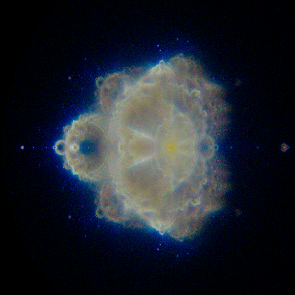

# buddhabrot-512

<p align="center">
  <a href="buddhabrot-100k.png">
    
  </a><br/>
  <em>Buddhabrot rendered at 103.55 MP (12,944 × 8,000) with 100,000 samples/thread (1.6M target escaped orbits, 1.79 s)</em>
</p>

A high-performance Buddhabrot renderer written in Common Lisp (SBCL), using AVX-512 SIMD for orbit iteration, cycle detection for pruning trapped orbits, and a self-contained OpenEXR writer with SIMD-accelerated RLE compression. This is coded during three days with help of Gemini and DeepSeek, guided by tests and measurements. The purpose is to just create a demo as a test to demonstrate that my new SBCL AVX-512 backend works as intended. I learned about Buddhabrot really just few days ago from an online discussion on Reddit. The code here is developed from the scratch.

Renders a 103.55-megapixel image (12,944 × 8,000) 5000 orbits/thread in roughly **0.2 seconds end-to-end** on a 10-core machine using 16 threads, of which ~0.09 s is orbit computation.

Includes optional GPU-accelerated denoising via Intel Open Image Denoise (OIDN).

---

## What It Does

The Buddhabrot technique (Melinda Green, 1993) visualizes the *trajectories (orbits)* of points that escape the Mandelbrot set, rather than the set itself. For each randomly sampled candidate `c` that escapes, the orbit sequence `z_n` is projected into the image plane, incrementing hit counters per pixel.

Orbits are color-coded by escape time:

**Blue channel**:  Short-lived orbits (20 to 500 iterations)
**Green channel**: Medium-lived orbits (500 to 5,000 iterations)
**Red channel**:   Long-lived orbits (5,000 to 100,000 iterations)

The characteristic astronomical "nebula" structure emerges when millions of points are projected onto the image.

---

## Requirements

This project was generated to demonstrate the AVX-512 backend for SBCL. So obviously, you need SBCL built with AVX-512 support and an AVX-512 capable CPU. Since there is no binary distributed, you will have to [download the source code](https://github.com/amno1/sbcl) and build one yourself. Be sure you build `sb-simd-512` worktree. You can just clone the repository and sh make.sh as you normally build SBCL.

The code unconditionally uses 16-wide `f32.16` (or 8-wide `f64.8`) floating-point operations and 64-wide `u8.64` integer intrinsics from sb-simd `avx512bw`. There is no scalar or avx2 fallback. Besides `sb-simd-avx512bw` for vector intrinsics and opmasks, we also use `sb-thread` for multi-threaded parallel workers and internal SBCL facilities (`sb-sys`, `sb-kernel`, `sb-int`) for pinned memory objects, SAP pointers, and floating-point trap controls. So yeah, this is completely unportable to other Common Lisp systems.

Both the OpenEXR header writer and the SIMD RLE compression codec are implemented directly inside `buddha-512.lisp` without third-party dependencies.

While reading about Buddhabrot and Monte Carlo sampling, there was some discussion about denoising the typical grainy images as random sampling (Monte Carlo) usually results in. I just stumbled upon [this Intel project](https://www.openimagedenoise.org/) with a neural net trained for the purpose, and thought I could try it and see how it works. I don't think I am happy with the result, but I have left it in for the fun, if someone wants to experiment with it. You will need to install **Intel Open Image Denoise (OIDN 2.x)** (for `libOpenImageDenoise.so.2`). My laptop has an Nvidia card in it so I use NVIDIA GPU via CUDA as the default accelerator selected by OIDN, but you may change it to something else. I have used SBCL's native `sb-alien` foreign function interface so you don't need CFFI (everything is SBCL specific anyway, so why bother).

---

## Usage

### Option 1: Via Makefile

```bash
# Render raw Buddhabrot (default 5,000 samples/thread = 80,000 target orbits):
make buddha

# Render with GPU-accelerated OIDN denoising:
make buddha-denoise

# Render with double samples (10,000 samples/thread = 160,000 target orbits):
make buddha SAMPLES=10000
make buddha-denoise SAMPLES=10000

# Specify custom thread count (e.g. 32 threads also doubles total sample count):
make buddha THREADS=32
make buddha-denoise THREADS=32

# Alias for 'make buddha':
make buddha-512

# Compile to FASL only:
make compile
```

### Option 2: Via Common Lisp REPL

```lisp
(load "buddha-512.lisp")

;; Render raw with default samples (5,000/thread):
(buddha:main 16)

;; Render with double samples (10,000/thread):
(buddha:main 16 10000)

;; Render with double samples and GPU OIDN denoising:
(buddha:main-denoise 16 10000)

;; Or full control via keyword arguments in RENDER:
(buddha:render :threads 16 :samples-per-thread 10000 :denoise t :output "buddhabrot-denoised.exr")
```

---

## Performance

Measured on a 16-core machine (Ryzen AI 9 365 / Zen 5), 80,000 sampled escaped orbits, canvas size 12,944 × 8,000 pixels (103.55 MP):

| Phase                                                        | Time        |
|:-------------------------------------------------------------|:------------|
| Buffer zeroing (parallel, untimed)                           | ~0.035 s    |
| AVX-512 orbit computation                                    | ~0.088 s    |
| Channel max scan (parallel)                                  | ~0.033 s    |
| Interleave + logarithmic LUT                                 | ~0.040 s    |
| SIMD RLE compression                                         | ~0.005 s    |
| Disk write (`buddhabrot.exr`)                                | ~0.004 s    |
| **Total Wall-Clock Time (Raw)**                              | **~0.20 s** |
| *Optional: Intel OIDN GPU Denoising (`make buddha-denoise`)* | *~1.68 s*   |

### Throughput Figures

- **~1.8 M effective orbits/sec** (after real-axis symmetry doubling)
- **~5.4 G Mandelbrot lane-iterations/sec** across all worker threads
- **~38 GB/s single-core RLE scan** (~5 ms across 32 threads for the full 103.55 MP EXR image)

---

## Why Is It Fast

Five core techniques contribute to this performance:

1. **AVX-512 `f32.16` Vectorized Orbit Iteration**
   Sixteen Mandelbrot orbits are stepped simultaneously per instruction.
   Single-precision floating point is sufficient at this canvas scale
   (`image-x / width ≈ 6.2e-4`, while `f32` retains ~7 decimal digits)
   and doubles the lane throughput relative to `f64.8`.

2. **Cycle Detection (K = 2520)** Some orbits fall into an infinite loop and
   would otherwise march to the bailout limit of 100,000 steps.  By comparing
   `z_n` against `z_{n−2520}` every 2,520 steps, 94.7% of trapped orbits are
   detected and pruned within their first comparison window. The interval is
   `lcm(1..10) = 2520`, catching any period from 1 through 10 in a single vector
   comparison.

3. **Real-Axis Symmetry**
   The Mandelbrot set is invariant under complex conjugation ($z \leftrightarrow \bar{z}$).
   Sampling candidates strictly from the upper half-plane (`ci ≥ 0`) and
   projecting both `(x, y)` and `(x, −y)` per orbit step halves the work.

4. **32-Bit Counters & Compact Memory Footprint**
   Observed peak pixel hit counts are ~1,500 at this sample count. An `(unsigned-byte 32)`
   buffer provides ~2.8 million× headroom before overflow. Halving the buffer size from
   2.48 GB to 1.24 GB substantially reduces memory-bus traffic across buffer clearing,
   deposit retracing, and maximum-value reduction passes.

5. **SIMD-Accelerated OpenEXR RLE Compression**
   The OpenEXR RLE codec operates as a byte-scan.
   - `count-run-simd` uses `u8.64` vector comparisons (`vpbroadcastb` + `vpcmpequb` + `kmovq` + bit-scan) to measure uniform runs up to 128 bytes in just two SIMD operations.
   - `find-3run-simd` performs a three-way vector comparison across 64-byte chunks to pinpoint literal boundaries.
   - Delivers a **~17× speedup** over scalar RLE while generating 100% spec-compliant OpenEXR output bytes.
   - Saves time when saving to the drive while also reducing the size on the drive

---

### Main Entry

```lisp
(buddha:render
  :threads 16                ; worker thread count
  :samples-per-thread 5000   ; target escaped orbits per thread
  :output "buddhabrot.exr"   ; output filename
  :width 12944               ; canvas width
  :height 8000               ; canvas height
  :pixel-type :half          ; :half (16-bit float) or :float (32-bit float)
  :tone-mapping :logarithmic ; :logarithmic or :linear (half only)
  :precision :single         ; :single (f32.16) or :double (f64.8)
  :compression :rle          ; :rle (default) or :none
  :atomic nil                ; T to use atomic-incf on pixel deposits
  :cycle-detection t         ; T to enable period-1..10 cycle pruning
  :denoise nil)              ; T to enable GPU OIDN denoising before EXR export
```

> **Note on Sampling**: `samples-per-thread` specifies the target *escaped orbit hit count*,
> not candidate count. Because candidates falling inside the Mandelbrot set or escaping in
> fewer than 20 steps (below `+min-bailout+`) are rejected, the actual number of candidates
> tested is roughly 30× the target count.

### Lower-Level Entry Points

- `(buddha:main &optional (threads 16) (denoise nil) (output "buddhabrot.exr"))` — Entry point for raw renders (denoiser bypassed).
- `(buddha:main-denoise &optional (threads 16) (output "buddhabrot-denoised.exr"))` — Entry point with GPU OIDN denoising enabled.
- `(buddha:denoise-buffer array width height &key scale threads hdr)` — Standalone function to filter a 32-bit integer hit buffer with OIDN on GPU.
- `(buddha:export-exr filename array w h &key (denoise nil) ...)` — Export an existing buffer to OpenEXR, optionally running OIDN before RLE compression.
- `(buddha:draw &key output pixel-type tone-mapping (denoise nil))` — Re-export the image buffer from the previous render.
- `buddha:*color-array*` — The global 32-bit image buffer (`12944 × 8000 × 3` words).

---

## Tuning Parameters

**Iteration Limit (`+max-bailout+`)**: Defaults to 100,000. Lowering to 25,000 trims very long escapes; the visual difference is primarily noticeable in the faint red channel filaments.

**Bailout Lower Bound (`+min-bailout+`)**: Defaults to 20. Raising this filters out very short escapes that contribute only broad background haze.

**Cycle Detection Interval (`+cycle-detection-interval+`)**: Defaults to 2,520 (`lcm(1..10)`). Increasing to 27,720 (`lcm(1..12)`) detects higher-period components at the expense of a larger snapshot array.

**Worker Threads**: Orbit computation and OpenEXR export match the configured thread count (defaults to 16 threads, avoiding CPU over-subscription on 16–20 thread machines).

---

## Limitations

We use single-precision floats so we can process 16 orbits at a time (`:precision :single`, `f32.16`). It breaks down under deeper zooms requiring more than ~7 decimal digits of precision. Use `:precision :double` (`f64.8`) for deep zooms at half the SIMD lane count (slower).

You will need a HDR/EXR-capable viewer (HALF and FLOAT pixel types with RLE or uncompressed channels), e.g. iv, Blender, tev, GIMP, Photoshop, or exrdisplay.

---

## License

MIT, following the header in `buddha-512.lisp`.

The Buddhabrot visualization technique is credited to Melinda Green (1993).
